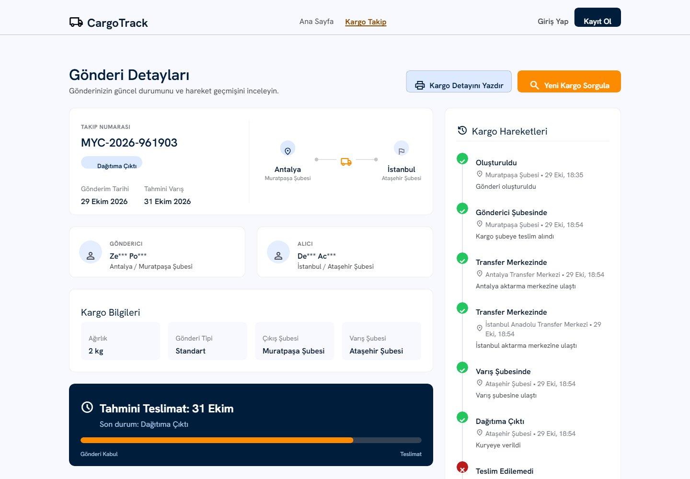
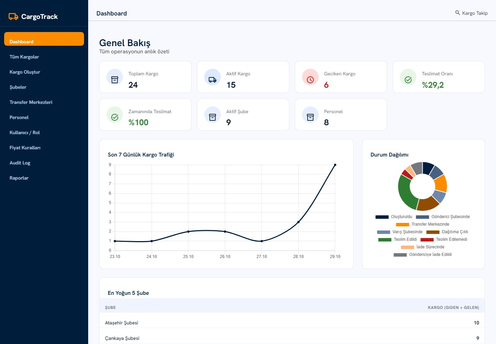
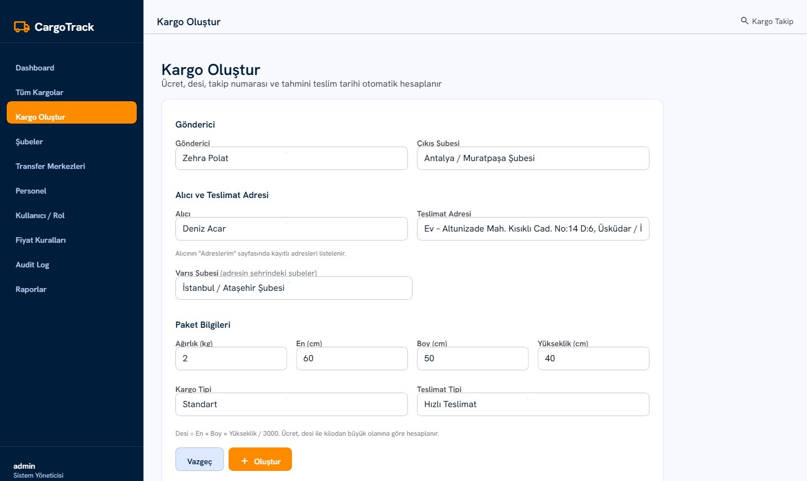
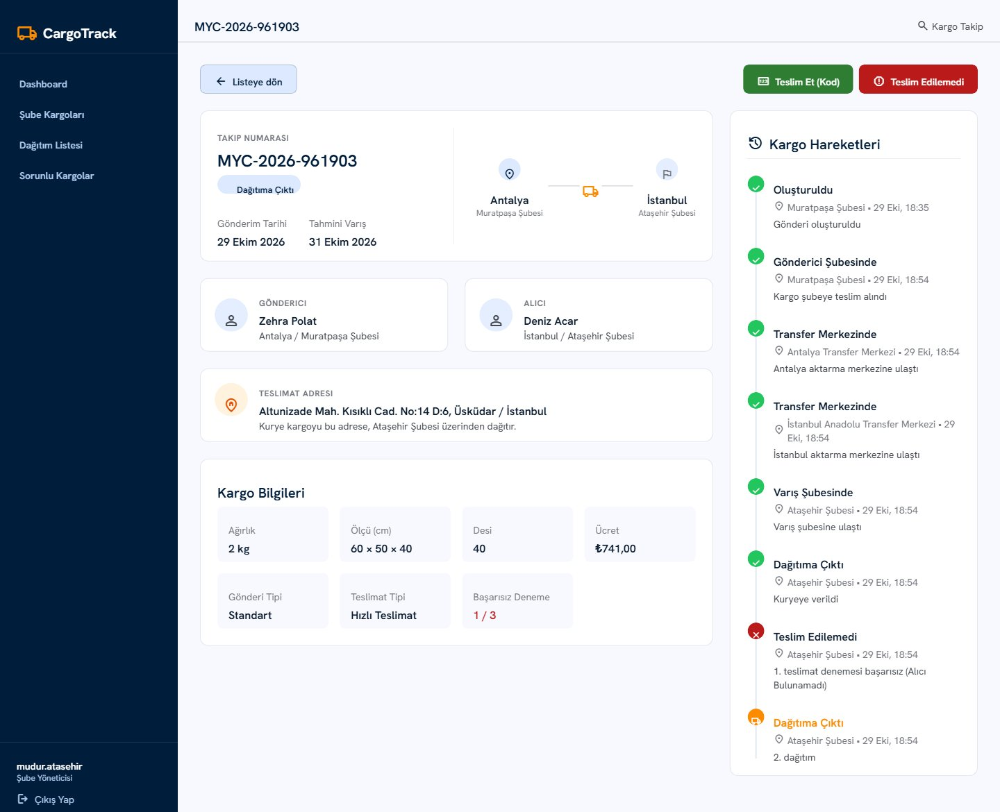
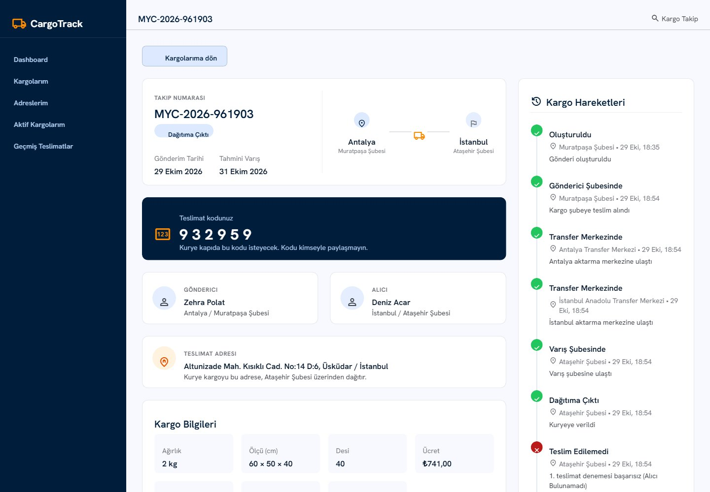
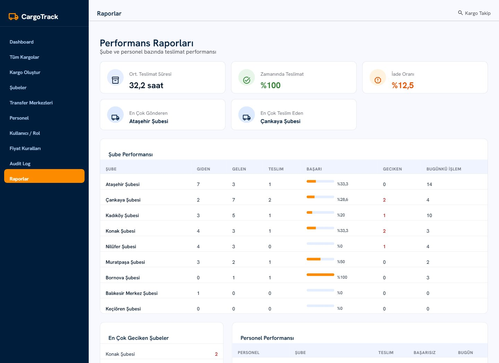
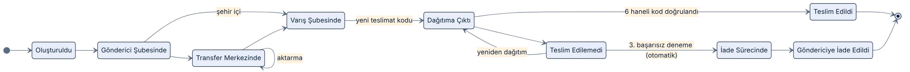
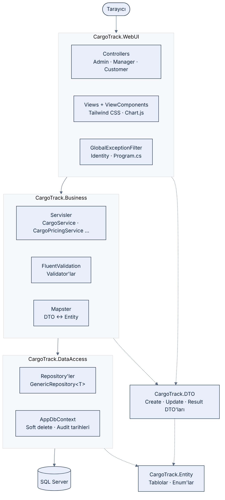
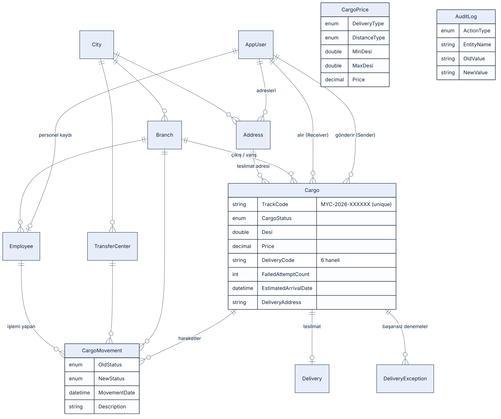

# 📦 CargoTrack: Kargo Takip ve Operasyon Yönetim Sistemi


**MyAcademy** eğitim programı kapsamında geliştirilen bir case study. Bir kargo şirketinin günlük operasyonunu uçtan uca yönetiyor: kargo kabulü, şubeler ve transfer merkezleri arasındaki hareketler, dinamik fiyatlandırma, kodla teslimat, başarısız teslimatta otomatik iade süreci, rol bazlı paneller ve raporlar.

Proje **N-katmanlı mimari** ile yazıldı. Her katmanın tek bir sorumluluğu var ve katmanlar arasındaki bağımlılık tek yönlü.

---

## 📸 Ekran Görüntüleri

| Herkese açık kargo takibi | Admin dashboard |
| :---: | :---: |
|  |  |
| **Kargo oluşturma (adres seçimli)** | **Şube müdürü: kargo detayı ve hareketler** |
|  |  |
| **Müşteri: teslimat kodu** | **Raporlar** |
|  |  |

---

## ✨ Özellikler

### Roller ve paneller

| Rol | Yapabildikleri |
| --- | --- |
| **Admin** | Kargo oluşturma, tüm kargoları listeleme ve filtreleme, şube / transfer merkezi / fiyat kuralı / personel yönetimi, rol atama, audit log, raporlar, dashboard grafikleri |
| **Manager** (şube müdürü) | Sadece kendi şubesinden çıkan veya şubesine gelen kargoları görür. Hareket girer, kodla teslim eder, başarısız teslimat bildirir. Dağıtım listesi ve sorunlu kargolar ekranları |
| **User** (müşteri) | Gelen ve giden kargolarını takip eder, teslimat kodunu görür, teslimat adreslerini yönetir |
| **Ziyaretçi** | Takip numarasıyla kargo sorgular. İsimler maskelenir, fiyat ve kod gösterilmez |

### Öne çıkan iş kuralları

- **Kontrollü durum geçişleri:** Kargo sadece izin verilen sırada ilerleyebilir (aşağıdaki diyagram). Her durum değişikliği `CargoMovement` tablosuna kaydedilir.
- **Durum ile konum uyumu:** "Gönderici Şubesinde" için çıkış şubesi, "Varış Şubesinde" ve "Dağıtıma Çıktı" için varış şubesi, "Transfer Merkezinde" için bir transfer merkezi zorunlu.
- **Dinamik fiyatlandırma:** `Desi = En × Boy × Yükseklik / 3000`. Ücret, **desi ile kilodan büyük olana** göre, teslimat tipi (Standart / Hızlı) ve mesafe (şehir içi / şehirler arası) için tanımlı fiyat aralığından hesaplanır. Fiyat aralıklarının çakışması engellenir.
- **SLA (tahmini teslim):** Hızlı + şehir içi 1 gün, hızlı + şehirler arası 2 gün, standart + şehir içi 2 gün, standart + şehirler arası 3 gün. Süresi geçen aktif kargolar "gecikmiş" olarak işaretlenir.
- **6 haneli teslimat kodu:** Kriptografik rastgele sayı üreteciyle (`RandomNumberGenerator`) oluşturulur ve kargo **her dağıtıma çıktığında yenilenir**. Kodu sadece alıcı görür. Kurye teslimatta alıcıdan ister.
- **3 başarısız deneme → otomatik iade:** Üçüncü başarısız teslimatta kargo kendiliğinden "İade Sürecinde" durumuna geçer.
- **Takip numarası:** `MYC-2026-XXXXXX` formatında, veritabanında benzersiz index ile korunur.
- **Teslimat adresi:** Alıcının kayıtlı adreslerinden biri seçilir. Varış şubesi adresle aynı şehirde olmalıdır. Adres metni kargoya kopyalanır, böylece müşteri adresini sonradan değiştirse de kargonun adresi korunur.
- **Soft delete:** Silinen kayıtlar veritabanından kaldırılmaz, `IsDeleted = true` olur ve global query filter ile sorgulardan gizlenir.
- **Audit log:** Kargo oluşturma ve durum değişiklikleri, işlemi yapan kullanıcıyla birlikte kaydedilir.

### Kargo yaşam döngüsü



---

## 🏗️ Mimari



| Proje | Sorumluluğu |
| --- | --- |
| **CargoTrack.Entity** | Veritabanı tabloları (entity'ler), enum'lar, `BaseEntity` (Id, tarihler, `IsDeleted`) |
| **CargoTrack.DataAccess** | `AppDbContext`, Fluent API ayarları, migration'lar, `GenericRepository<T>` ve özel repository'ler |
| **CargoTrack.DTO** | Katmanlar arasında taşınan veri sınıfları: Create / Update / Result / Filter DTO'ları |
| **CargoTrack.Business** | İş kuralları: servisler, FluentValidation validator'ları, Mapster ayarları, `BusinessException` |
| **CargoTrack.WebUI** | Controller'lar (Areas: Admin, Manager, Customer), View'lar, ViewComponent'ler, Identity, global hata yönetimi |

**Bağımlılık yönü:** `WebUI → Business → DataAccess → Entity`. DTO projesini Business ve WebUI kullanır. WebUI hiçbir zaman doğrudan veritabanına erişmez.

**Üç katmanlı yetki kontrolü:**
1. **Menü:** Sidebar ViewComponent, kullanıcının rolüne göre menü üretir.
2. **Controller:** `[Authorize(Roles = ...)]` ile her area kendi rolüne kapalıdır.
3. **Servis:** Veriler kullanıcıya göre filtrelenir. Müdür sadece kendi şubesinin, müşteri sadece kendi kargolarını ve adreslerini görebilir. URL'deki Id değiştirilse bile erişim engellenir (IDOR koruması).

<br clear="right" />

---

## 🗄️ Veritabanı



- Bütün entity'ler `BaseEntity`'den türer: `Id (Guid)`, `CreatedDate`, `UpdatedDate`, `IsDeleted`.
- `CreatedDate` / `UpdatedDate` alanları ve soft delete, `AppDbContext.SaveChangesAsync` override'ında otomatik yönetilir.
- Zincirleme silme (cascade) bütün ilişkilerde kapalıdır (`DeleteBehavior.Restrict`).
- Navigation property'ler `virtual` tanımlıdır ve lazy loading proxy'leri ile yüklenir. Listelerde N+1 sorgu problemini önlemek için Mapster `ProjectToType` ile SQL tarafında projeksiyon yapılır.

---

## 🧰 Kullanılan Teknolojiler

| Alan | Teknoloji |
| --- | --- |
| Framework | .NET 8, ASP.NET Core MVC |
| ORM | Entity Framework Core 8 (Code First, Migrations, Lazy Loading Proxies) |
| Veritabanı | Microsoft SQL Server |
| Kimlik doğrulama | ASP.NET Core Identity (`AppUser : IdentityUser<Guid>`) |
| Doğrulama | FluentValidation (sunucu + istemci tarafı) |
| Nesne eşleme | Mapster (`Adapt`, `ProjectToType`, flattening) |
| Arayüz | Razor Views, ViewComponents, Tailwind CSS, Material Symbols |
| Grafikler | Chart.js |

---

## 🚀 Kurulum

### Gereksinimler

- [.NET 8 SDK](https://dotnet.microsoft.com/download/dotnet/8.0)
- SQL Server (Express veya LocalDB)
- Visual Studio 2022 (önerilen) ya da `dotnet` CLI

### Adımlar

```bash
git clone https://github.com/KorayhanAvcu/MyAcademy_CargoTrack.git
cd MyAcademy_CargoTrack
```

1. `CargoTrack.WebUI/appsettings.json` dosyasındaki bağlantı cümlesini kendi SQL Server'ına göre düzenle:

   ```json
   "ConnectionStrings": {
     "DefaultConnection": "Server=.\\SQLEXPRESS;Database=CargoTrackDb;Integrated Security=true;TrustServerCertificate=true"
   }
   ```

2. Uygulamayı çalıştır:

   ```bash
   dotnet run --project CargoTrack.WebUI
   ```

   Uygulama açılırken **migration'ları otomatik uygular** ve geliştirme ortamında örnek verileri yükler: şehirler, şubeler, transfer merkezleri, fiyat kuralları, kullanıcılar ve farklı durumlarda 17 örnek kargo. Ayrıca `Update-Database` çalıştırman gerekmez.

3. Tarayıcıda `https://localhost:xxxx` adresini aç.

### Test hesapları

> Bu hesaplar sadece yerel geliştirme ortamı için seed ile oluşturulur.

| Rol | Kullanıcı adı | Şifre |
| --- | --- | --- |
| Admin | `admin` | `Admin123*` |
| Şube müdürü | `mudur.atasehir`, `mudur.kadikoy`, `mudur.konak` ... | `Mudur123*` |
| Müşteri | `musteri1` … `musteri6` | `Musteri123*` |

---

## 📁 Proje Yapısı

```
MyAcademy_CargoTrack
├── CargoTrack.Entity
│   └── Entities/            Cargo, CargoMovement, Branch, Address, Employee ... + Enums/
├── CargoTrack.DataAccess
│   ├── Context/             AppDbContext (Fluent API, soft delete, audit tarihleri)
│   ├── Repositories/        GenericRepository<T> + her tablo için repository
│   └── Migrations/
├── CargoTrack.DTO
│   └── DTOs/                Cargos/, AddressDtos/, DashboardDtos/, ReportDtos/, Common/PagedResultDto ...
├── CargoTrack.Business
│   ├── Services/            CargoService, CargoPricingService, DashboardService, ReportService ...
│   ├── Validators/          FluentValidation kuralları
│   ├── Helpers/             Sayfalama, isim maskeleme, sorgu kısayolları
│   ├── Mappings/            MapsterConfig
│   └── Exceptions/          BusinessException
└── CargoTrack.WebUI
    ├── Areas/
    │   ├── Admin/           Kargo, şube, transfer merkezi, fiyat, personel, rol, rapor, audit log
    │   ├── Manager/         Şube kargoları, hareket, teslimat, sorunlu kargolar
    │   └── Customer/        Kargolarım, adreslerim, dashboard
    ├── Controllers/         Ana sayfa (takip), giriş, kayıt, hata sayfaları
    ├── ViewComponents/      Sidebar, CargoTable, CargoDetail, StatusBadge, Pagination, dashboard'lar ...
    ├── Filters/             GlobalExceptionFilter
    ├── ModelBinders/        Ondalık sayılarda virgül ve noktayı kabul eden binder
    └── Seed/                SampleDataSeeder (örnek veri)
```

---

## 🔒 Güvenlik Önlemleri

- Bütün POST isteklerinde anti-forgery token zorunlu (`AutoValidateAntiforgeryTokenAttribute`). Silme işlemleri de form ile yapılır.
- Formdan gelmemesi gereken alanlar (fiyat, durum, takip no, kayıt sahibi) DTO'larda yer almaz. Bu, overposting saldırısını engeller.
- Başka kullanıcıya veya şubeye ait kayıtlara URL üzerinden erişim engellenir.
- Teslimat kodu kriptografik rastgele sayı üreteciyle üretilir ve sadece alıcıya gösterilir.
- Herkese açık takip ekranında isimler maskelenir (`Ah*** Ku***`).
- Hatalar kullanıcıya teknik detay gösterilmeden ele alınır: iş kuralı ihlalleri uyarı mesajı olarak, yetkisiz erişimler "Erişim engellendi" sayfası olarak gösterilir.

---

## 👤 Geliştirici

**Korayhan Avcu**: [GitHub](https://github.com/KorayhanAvcu)

MyAcademy Case Study, 2026
